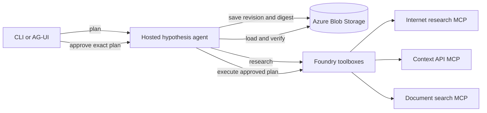

# Human-approved hypothesis workflow

A Microsoft Foundry hosted agent that turns a scenario into an evidence-gathering
plan, pauses for explicit human approval, and then executes the exact approved
revision. The workflow is designed for long-running reasoning where planning and
execution must be separated by a durable, auditable approval boundary.

## How it works

1. A caller submits a scenario with the `plan` action.
2. The agent formulates a hypothesis and a tool-backed execution plan.
3. The plan is stored in Azure Blob Storage with a revision and SHA-256 digest.
4. The caller approves, rejects, or requests revision using that exact revision
   and digest.
5. An approved plan resumes in execute mode and returns the evidence-backed
   result.

The agent fails closed when the approval does not match the current stored plan
or when the Foundry gateway does not provide an authenticated caller identity.
Workflow records use optimistic concurrency and expire after a configurable TTL.



## Repository layout

```text
infra/                         Foundry, model, ACR, storage, and monitoring
scripts/                       Provisioned-resource deployment and CLI tools
src/hosted_hypothesis_agent/   Agent host, orchestration, models, and Blob store
src/hypothesis_ag_ui/          Local React console and authenticated adapter
src/weather_mcp_server/        Generated weather MCP service for testing
tests/                         Workflow, orchestration, and adapter tests
```

## Prerequisites

- Python 3.13+
- Azure CLI and Azure Developer CLI
- An Azure subscription with model quota in the selected region
- Three read-only MCP services for internet research, context retrieval, and
  document search

Authenticate and install the local dependencies:

```bash
az login
azd auth login
python3 -m pip install -r requirements.txt
```

## Configure

Provisioning writes Azure settings to `.env`. For production scenarios,
configure the three source MCP URLs before registering the toolboxes:

```dotenv
INTERNET_RESEARCH_MCP_URL=https://<internet-research-service>/mcp
CONTEXT_API_MCP_URL=https://<context-api-service>/mcp
DOCUMENT_SEARCH_MCP_URL=https://<document-search-service>/mcp
```

See [.env.sample](.env.sample) for all supported settings. Optional
comma-separated allowlists can restrict the tools exposed from each toolbox.

For development, the included weather MCP server can stand in for any unset
source URL. This fallback is for connectivity testing only; its tools do not
provide internet, context API, or document-search semantics.

## Deploy

Provision the Foundry project, model, container registry, Blob Storage,
Container Apps environment, and monitoring resources:

```bash
azd up
```

Deploy the generated weather MCP server and optionally register it as its own
Foundry toolbox:

```bash
python3 -m scripts.deploy_weather_mcp_server
python3 -m scripts.register_weather_toolbox
```

The deployment records `WEATHER_MCP_URL` in `.env`. When one of the three
hypothesis `*_MCP_URL` values is unset, `register_hypothesis_toolboxes` uses that
weather URL as a test fallback.

Register the MCP services as Foundry toolboxes, then build and deploy the hosted
agent image:

```bash
python3 -m scripts.register_hypothesis_toolboxes
python3 -m scripts.deploy_hosted_hypothesis_agent
```

The deployment waits for the new agent version to become active, grants its
instance identity access to the model, toolboxes, and workflow storage, then
routes all traffic to that version.

## Invoke

Create a plan:

```bash
python3 -m scripts.invoke_hypothesis_agent plan \
  "Investigate whether the proposed scenario is supported by current evidence"
```

Approve the exact revision and digest returned by the plan call:

```bash
python3 -m scripts.invoke_hypothesis_agent decide \
  <workflow-id> <revision> <sha256:digest> approved
```

Use `rejected` or `revise` instead of `approved` when appropriate. Inspect the
latest durable state with:

```bash
python3 -m scripts.invoke_hypothesis_agent status <workflow-id>
```

## Run the UI

Build the React frontend and start the local authenticated adapter:

```bash
cd src/hypothesis_ag_ui/frontend
npm install
npm run build
cd ../../..
python3 -m pip install -r src/hypothesis_ag_ui/requirements.txt
python3 -m src.hypothesis_ag_ui.server
```

Open <http://127.0.0.1:5178>. The adapter uses `DefaultAzureCredential` and the
deployed agent name from `.env`.

## Test

```bash
python3 -m unittest discover -s tests/hosted_hypothesis_agent -p 'test_*.py'
python3 -m unittest discover -s tests/hypothesis_ag_ui -p 'test_*.py'
cd src/hypothesis_ag_ui/frontend && npm run build
```

The deployed two-phase flow also has smoke-test scripts:

```bash
python3 -m scripts.test_hypothesis_plan
python3 -m scripts.test_hypothesis_approval
```

See [AGENTS.md](AGENTS.md) for operational procedures and troubleshooting.

## Clean up

```bash
python3 -m scripts.delete_agents
azd down
```